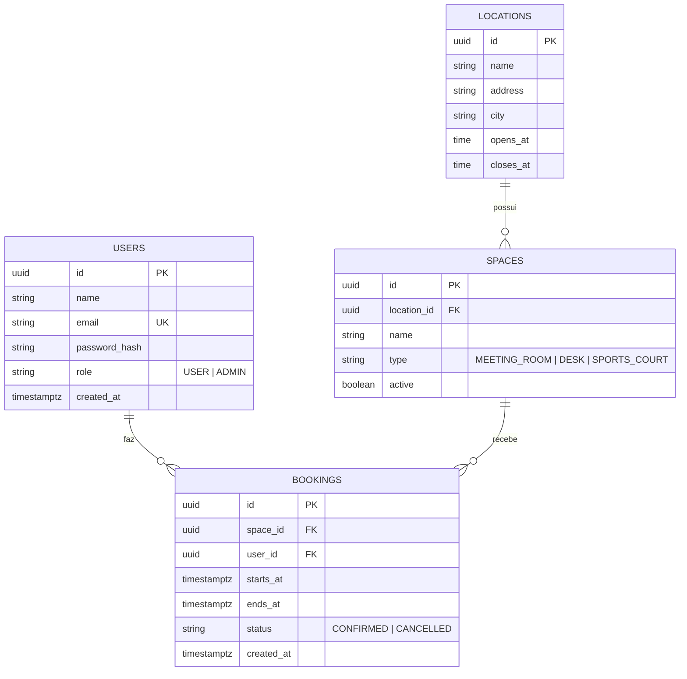

# 🏢 API de Reservas de Espaços (salas, coworking, quadras)

> **Status:** ✅ planejamento fechado, pronto para a Fase 0. Este README é o esqueleto vivo do projeto: vamos ajustar as ideias aqui
> antes de escrever código. Decisões fechadas na seção 12.
> O README final, voltado a recrutadores, será reescrito em **inglês** no fim do projeto (seção 11).

---

## 1. Visão geral

**Problema:** reservar salas de reunião, mesas de coworking ou quadras costuma ser por
WhatsApp, telefone ou planilha. Gera choque de horário, ninguém sabe o que está livre e o dono não tem visão de uso.

**Solução:** uma API REST que permite a usuários se cadastrar, ver a disponibilidade de espaços e reservar
horários, com regras de negócio claras (sem sobreposição, antecedência mínima, limite por usuário, cancelamento).
Administradores gerenciam locais e espaços.

**Por que este projeto (objetivo de carreira):** provar, com link no ar, as competências que mais apareceram
como "não" nas vagas: **Java + Spring Boot, API REST, JWT, PostgreSQL, testes, Docker, CI/CD e nuvem**.

**Fora de escopo (por enquanto):** frontend, pagamentos reais, notificações por e-mail, app mobile.
(Ficam em "Evoluções", seção 10.)

---

## 2. Escopo

### MVP (o que precisa existir para valer no CV)
- [ ] Cadastro e login (JWT), papéis `USER` e `ADMIN`
- [ ] CRUD de **locais** (prédio, clube) e **espaços** (sala, mesa, quadra), só admin
- [ ] Consulta de **disponibilidade** de um espaço por dia
- [ ] Criar, listar e **cancelar reservas**
- [ ] Regras de horário (seção 5), sem sobreposição garantida também no banco
- [ ] Documentação Swagger/OpenAPI
- [ ] Testes unitários e de integração (Testcontainers)
- [ ] Dockerfile + docker-compose (app + Postgres)
- [ ] CI no GitHub Actions (build + testes) com selo no README
- [ ] Deploy público

### Depois do MVP (se der tempo)
- Reservas recorrentes (toda terça às 20h)
- Preços por faixa horária
- Lista de espera
- Envio de e-mail de confirmação
- Frontend simples

---

## 3. Stack

| Camada | Escolha | Observação |
|---|---|---|
| Linguagem | **Java 21** | LTS atual |
| Framework | **Spring Boot 4.2** | Web, Data JPA, Security, Validation |
| Banco | **PostgreSQL 16** | `tstzrange` + constraint de exclusão (seção 4) |
| Migrações | **Flyway** | Esquema versionado, nada de `ddl-auto=update` |
| Auth | **Spring Security + JWT** | Só access token (1–2 h), sem refresh token |
| Docs | **springdoc-openapi** | Swagger UI em `/swagger-ui.html` |
| Testes | **JUnit 5, Mockito, Testcontainers, MockMvc** | Postgres real nos testes de integração |
| Build | **Maven** | Maven é o mais pedido nas vagas |
| Mapeamento | **Mapeamento manual** | Manual é mais simples para começar |
| Container | **Docker + docker-compose** | Build multi-stage |
| CI/CD | **GitHub Actions** | Build, testes, imagem Docker |
| Deploy | **Render + Neon** | Cold start no plano grátis; Postgres no Neon |

---

## 4. Modelo de dados



**Garantia de não sobreposição no banco** (a regra mais importante, não confiar só no código):

```sql
CREATE EXTENSION IF NOT EXISTS btree_gist;

ALTER TABLE bookings
  ADD CONSTRAINT no_overlapping_bookings
  EXCLUDE USING gist (
    space_id WITH =,
    tstzrange(starts_at, ends_at) WITH &&
  ) WHERE (status = 'CONFIRMED');
```

Assim, duas requisições simultâneas para o mesmo horário nunca criam duas reservas: a segunda falha no banco
e a API devolve `409 Conflict`. Isso vira um **teste de concorrência** e um bom parágrafo no README.

---

## 5. Regras de negócio

| # | Regra | Valor |
|---|---|---|
| R1 | Reserva dentro do horário de funcionamento da local | `opens_at`–`closes_at` |
| R2 | Duração fixa | 60 min |
| R3 | Início alinhado à hora cheia (ou meia hora) | `:00` e `:30` |
| R4 | Sem sobreposição no mesmo espaço | constraint no banco |
| R5 | Não reservar no passado | `starts_at > now()` |
| R6 | Antecedência máxima | 14 dias |
| R7 | Limite de reservas futuras ativas por usuário | 3 |
| R8 | Cancelamento só pelo dono da reserva (ou admin) | |
| R9 | Cancelar com antecedência mínima | ≥ 2 h antes |
| R10 | Espaço inativo não aceita reservas | |

Fuso horário: guardar tudo em UTC (`timestamptz`) e converter para `Europe/Madrid` na borda.

---

## 6. API (endpoints)

Base: `/api/v1`. Erros no formato **RFC 7807** (`application/problem+json`).

### Autenticação
| Método | Rota | Acesso | Descrição |
|---|---|---|---|
| POST | `/auth/register` | público | Cadastro |
| POST | `/auth/login` | público | Devolve JWT |
| GET | `/users/me` | autenticado | Dados do usuário logado |

### Locais e espaços
| Método | Rota | Acesso | Descrição |
|---|---|---|---|
| GET | `/locations` | público | Lista instalações |
| POST / PUT / DELETE | `/locations[/{id}]` | ADMIN | Gerenciar |
| GET | `/locations/{id}/spaces` | público | Espaços do local |
| POST / PUT / DELETE | `/spaces[/{id}]` | ADMIN | Gerenciar |
| GET | `/spaces/{id}/availability?date=2026-12-01` | público | Horários livres do dia |

### Reservas
| Método | Rota | Acesso | Descrição |
|---|---|---|---|
| POST | `/bookings` | USER | Cria reserva |
| GET | `/bookings/me?status=&from=&to=` | USER | Minhas reservas (paginado) |
| GET | `/bookings/{id}` | dono/ADMIN | Detalhe |
| DELETE | `/bookings/{id}` | dono/ADMIN | Cancela (status → `CANCELLED`) |
| GET | `/admin/bookings?spaceId=&date=` | ADMIN | Visão do dono |

### Códigos de resposta esperados
`201` criado · `400` validação · `401` sem token · `403` sem permissão · `404` não existe ·
`409` conflito de horário ou regra violada · `422` regra de negócio (ex.: fora do horário)

---

## 7. Arquitetura e estrutura de pastas

Monólito em camadas, organizado **por funcionalidade** (não por tipo técnico):

```
api-reservas-espacos/
├── pom.xml
├── Dockerfile
├── docker-compose.yml
├── .github/workflows/ci.yml
├── docs/                    # diagramas, prints, GIF do Swagger
├── src/main/java/com/thiago/reservas/
│   ├── ReservasApplication.java
│   ├── config/              # Security, OpenAPI, Clock, CORS
│   ├── common/              # exceções, handler global (ProblemDetail), paginação
│   ├── auth/                # controller, service, JWT (filtro, provider), DTOs
│   ├── user/                # entity, repository, service
│   ├── location/           # entity, repository, service, controller, DTOs
│   ├── space/              # idem + availability
│   └── booking/             # idem + regras de negócio (BookingPolicy)
├── src/main/resources/
│   ├── application.yml
│   ├── application-dev.yml
│   └── db/migration/        # V1__schema.sql, V2__constraint.sql, V3__seed.sql
└── src/test/java/...        # unit/ e integration/
```

Fluxo: `Controller (DTO) → Service (regras) → Repository (JPA) → PostgreSQL`.
Decisões de design: entidades nunca saem nos controllers; `Clock` injetado para testar tempo; regras isoladas
em uma classe `BookingPolicy` fácil de testar.

---

## 8. Roadmap passo a passo

Cada fase termina com um critério **"pronto quando"** verificável. Estimativa total: **~3 semanas**.

### Fase 0: Preparação (½ dia)
- [ ] Criar repositório no GitHub (`space-booking-api`), licença MIT, `.gitignore`
- [x] Instalar/validar: JDK 21, Maven, Docker Desktop
- [x] Gerar projeto no start.spring.io: Web, Validation, Data JPA, Security, PostgreSQL, Flyway, Actuator, Testcontainers
- [x] Primeiro commit local e workflow de CI (`./mvnw verify`)
- **Pronto quando:** `mvn verify` passa local e no GitHub Actions.

### Fase 1: Banco e domínio (2 dias)
- [ ] `docker-compose.yml` só com Postgres
- [ ] Migrações Flyway V1 (tabelas) e V2 (constraint de exclusão)
- [ ] Entidades JPA e repositórios
- [ ] Seed de dados (2 locais de Elche (um coworking e um polidesportivo), 6 espaços, 1 admin)
- **Pronto quando:** app sobe, Flyway aplica as migrações, seed visível no banco.

### Fase 2: Autenticação (3 dias)
- [ ] `POST /auth/register` com validação e senha em BCrypt
- [ ] `POST /auth/login` devolvendo JWT (claims: `sub`, `role`, `exp`)
- [ ] Filtro JWT e regras de acesso por rota/papel
- [ ] Handler global de erros (`ProblemDetail`)
- [ ] Testes: cadastro duplicado, senha errada, rota protegida sem token
- **Pronto quando:** consigo logar no Swagger e acessar `/users/me`.

### Fase 3: Locais e espaços (2 dias)
- [ ] CRUD de locais e espaços (somente ADMIN escreve)
- [ ] Paginação e filtros (`type`, `city`)
- [ ] Testes de controller com MockMvc
- **Pronto quando:** admin cria espaço, usuário comum só consegue listar.

### Fase 4: Reservas e regras (4 dias) ⭐ núcleo do projeto
- [ ] `BookingPolicy` com R1–R10, cada regra com teste unitário
- [ ] `POST /bookings`, `GET /bookings/me`, `DELETE /bookings/{id}`
- [ ] Tradução do erro da constraint em `409 Conflict`
- [ ] `GET /spaces/{id}/availability`
- [ ] **Teste de concorrência**: 10 threads reservando o mesmo horário, só 1 vence
- **Pronto quando:** todas as regras têm teste verde e o teste de concorrência passa de forma estável.

### Fase 5: Qualidade (2 dias)
- [ ] Testes de integração com **Testcontainers** (Postgres real)
- [ ] Cobertura com JaCoCo (meta ≥ 80% em `service` e `booking`)
- [ ] Springdoc: exemplos, descrições e esquema de segurança Bearer
- [ ] Logs estruturados e `Actuator /health`
- **Pronto quando:** `mvn verify` roda tudo e o relatório de cobertura é gerado.

### Fase 6: Docker (1 dia)
- [ ] `Dockerfile` multi-stage (build com Maven, run com JRE slim, usuário não-root)
- [ ] `docker-compose.yml` completo (app + Postgres + healthcheck)
- [ ] Configuração por variáveis de ambiente (nada de segredo no repositório)
- **Pronto quando:** `docker compose up` sobe tudo do zero e o Swagger abre.

### Fase 7: CI/CD (1 dia)
- [ ] Workflow: checkout → JDK 21 → cache Maven → `mvn verify` → relatório JaCoCo
- [ ] Build e push da imagem para o GitHub Container Registry
- [ ] Selo de CI no README
- **Pronto quando:** push na `main` roda tudo e o selo fica verde.

### Fase 8: Deploy (1–2 dias)
- [ ] Postgres gerenciado no Neon
- [ ] Deploy da imagem, variáveis de ambiente, `/actuator/health` como health check
- [ ] Deploy automático após o CI passar
- [ ] Dados de demonstração e usuário de teste documentados
- **Pronto quando:** abro o Swagger público e faço um fluxo completo (cadastro → login → reserva → cancelamento).

### Fase 9: Apresentação (1–2 dias)
- [ ] README final em inglês (seção 11)
- [ ] Diagramas (ER, arquitetura) e GIF do fluxo no Swagger
- [ ] Atualizar CV, LinkedIn (Projetos e Destaque) e GitHub (pin)
- [ ] 1 post contando a história e o desafio da concorrência
- **Pronto quando:** link no ar + post publicado + CV atualizado.

### Cronograma resumido

| Semana | Fases | Entrega |
|---|---|---|
| 1 | 0, 1, 2, 3 | Login e CRUD funcionando |
| 2 | 4, 5 | Reservas com regras e testes |
| 3 | 6, 7, 8, 9 | Docker, CI, deploy e post |

---

## 9. Estratégia de testes

| Tipo | Ferramenta | O que cobre |
|---|---|---|
| Unitário | JUnit 5 + Mockito | `BookingPolicy`, services, JWT |
| Fatia web | `@WebMvcTest` + MockMvc | Validação, códigos HTTP, segurança por rota |
| Integração | `@SpringBootTest` + Testcontainers | Fluxos completos com Postgres real, migrações |
| Concorrência | `ExecutorService` | Só uma reserva vence no mesmo horário |
| Contrato | Swagger gerado | Checagem manual da documentação |

---

## 10. Evoluções possíveis
1. Frontend em React ou Astro consumindo a API (liga com o projeto de portfólio #15)
2. Reservas recorrentes e lista de espera
3. E-mail de confirmação (Spring Mail + MailHog local)
4. Cache de disponibilidade (Redis) e rate limiting
5. Observabilidade: Micrometer + Prometheus + Grafana
6. Migrar o módulo de notificações para evento (liga com o projeto #10, Kafka)

---

## 11. Estrutura do README final (para recrutadores, em inglês)
1. Título, selos (CI, Java, licença) e **link da demo** no topo
2. *What it is* em 2 frases + GIF do Swagger
3. **Key features** e **business rules**
4. **Architecture** (diagrama) e **data model**
5. **Design decisions** (constraint de exclusão, `Clock` injetado, ProblemDetail, Testcontainers)
6. **How to run** (`docker compose up`) e **how to test** (`mvn verify`)
7. **API overview** (tabela de endpoints) e credenciais de demo
8. **What I learned** e próximos passos

---

## 12. Decisões tomadas

| # | Decisão | Escolha |
|---|---|---|
| 1 | Domínio | **Genérico**: locais com espaços de tipos variados (sala, mesa, quadra). Seed de Elche |
| 2 | Deploy | **Render + Neon** (aceitar cold start; documentar no README) |
| 3 | Auth | **Só access token** (JWT 1–2 h) |
| 4 | Duração e papéis | **60 min fixo**, papéis `USER` e `ADMIN` |
| 5 | Build | **Maven** |
| 6 | Mapeamento DTO | **Manual** (sem MapStruct) |
| 7 | Idioma | **Inglês** no código, commits e API; planejamento em português |
| 8 | Regras | R6 = 14 dias, R7 = 3 reservas ativas, R9 = cancelar com 2 h. Sem no-show nem bloqueio por manutenção no MVP |
| 9 | Java | **21** (LTS). Spring Boot **4.2** (o start.spring.io só oferece 4.x em nov/2026) |
| 10 | Repositório | **`space-booking-api`** |

Nenhuma decisão em aberto. Próximo passo: Fase 0.
