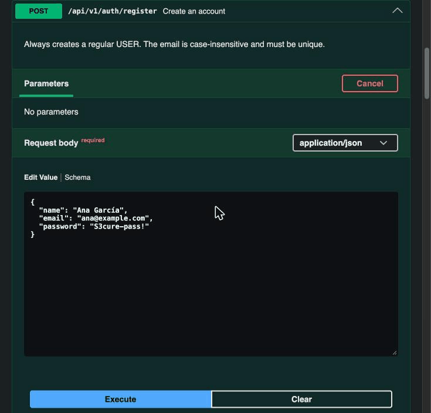
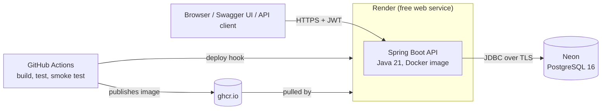
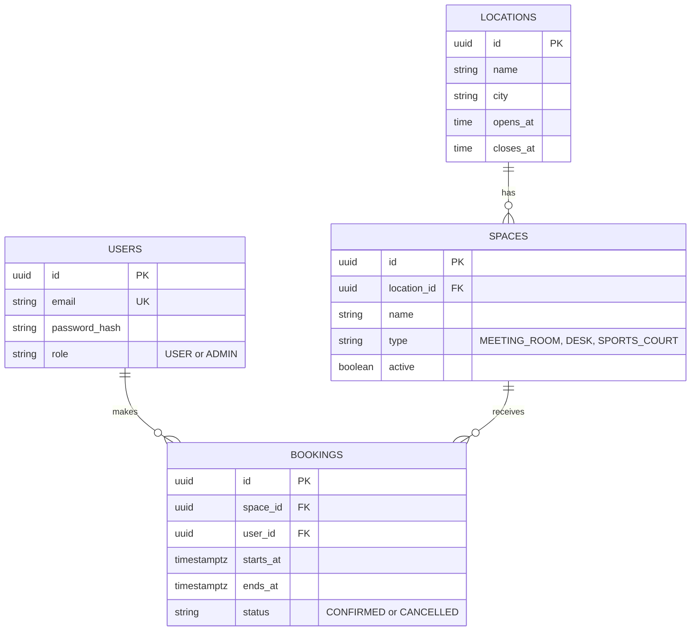
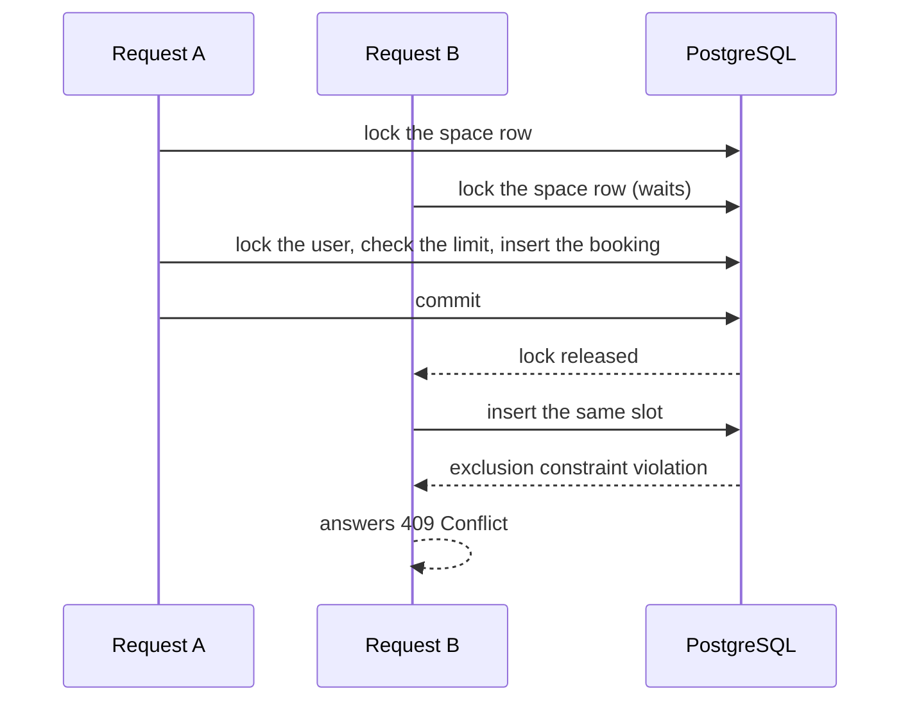

# Space Booking API

[](https://github.com/thiagoCardoso13/space-booking-api/actions/workflows/ci.yml)


A REST API to book meeting rooms, coworking desks and sports courts. Built with **Java 21, Spring Boot 4, PostgreSQL,
JWT, Docker and GitHub Actions**, tested against a real database and deployed automatically on every push to `main`.

### 🔗 Live demo: [space-booking-api-dtam.onrender.com/swagger-ui.html](https://space-booking-api-dtam.onrender.com/swagger-ui.html)

> The demo runs on free hosting (Render + Neon), which puts the service to sleep after 15 minutes without traffic.
> **The first request after a quiet period can take 1-2 minutes** while the application starts again; after that it is fast.
> Opening the [health endpoint](https://space-booking-api-dtam.onrender.com/actuator/health/liveness) first is a good way to wake it up.

## The problem worth solving

Booking is easy until two people try to book the same slot at the same moment. This project is about getting that
right, not only about CRUD:

- **No double bookings, even under concurrency.** The guarantee lives in PostgreSQL (an exclusion constraint over time
  ranges), not only in application code. Tests fire parallel requests at the same slot and only one wins.
- **Business rules that are easy to read and to test.** Opening hours in the local time zone, one-hour slots, advance
  limits, a per-user limit and cancellation notice live in one small `BookingPolicy` class with one unit test per rule.
- **An API that documents itself accurately.** The OpenAPI document is checked by a test against what the security
  configuration really enforces, so the docs cannot lie about who can call what.

## What it does

- Sign up and log in with **JWT** (roles `USER` and `ADMIN`).
- Admins manage **locations** and **spaces** (rooms, desks, courts); everybody can browse them.
- **Availability** per space and day, in one-hour slots, in the location's time zone.
- **Bookings** with ten business rules (opening hours, no overlaps, advance limit, per-user limit, cancellation notice...).
  Rule violations answer `422` with a machine readable `rule` code; a slot that is already taken answers `409`.
- Paginated listings with filters, errors as **RFC 7807** `application/problem+json`, interactive **Swagger UI**.



## Architecture



A layered monolith organized **by feature** (`auth`, `user`, `location`, `space`, `booking`): controllers take and
return DTOs, services hold the rules, repositories talk to PostgreSQL through JPA. The schema is versioned with Flyway.

### Data model



## Design decisions

**1. The database decides who gets the slot.** An exclusion constraint makes two confirmed bookings of the same space
with overlapping time ranges impossible; cancelled bookings do not block the slot, and back-to-back bookings are allowed.

```sql
ALTER TABLE bookings ADD CONSTRAINT no_overlapping_bookings
  EXCLUDE USING gist (space_id WITH =, tstzrange(starts_at, ends_at) WITH &&)
  WHERE (status = 'CONFIRMED');
```

**2. A deadlock found by CI, and how it was fixed.** With ten simultaneous requests for one slot, PostgreSQL sometimes
aborted a few inserts with `deadlock detected` while checking that constraint, which showed up as `500` instead of `409`
on the CI runner (it had passed on my laptop). The stress test that reproduces it failed on every run before the fix.
Retrying alone worked but was slow, because PostgreSQL only detects a deadlock after one second. The real fix is to
serialize bookings per space: every booking first locks the space row, then the user row (always in that order, so
requests cannot wait on each other in a cycle). The loser now waits for the winner's commit and gets a clean `409`.



The user lock is also what keeps the "at most 3 active bookings" rule true when one user sends parallel requests
(a test that fails without the lock proves it). A small retry wrapper remains as a safety net for other lock failures.

**3. Time zones.** Instants are stored in UTC (`timestamptz`); opening hours and slot alignment are interpreted in
`Europe/Madrid`, including daylight saving time (covered by tests).

**4. Secure by default.** The Docker image starts with the `prod` profile, which refuses to boot without `JWT_SECRET`,
logs structured JSON and runs as a non-root user. Booking details are only visible to the owner or an admin (others get
`404`, so the existence of a booking is not leaked). Login answers identically for an unknown email and a wrong password.

**5. The docs are tested.** A test calls every documented operation as a regular user and checks that the OpenAPI
document lists a `403` exactly where the security configuration answers `403`.

## Business rules

| Rule | Description |
|---|---|
| R1 | A booking must fit inside the location's opening hours (Madrid time) and end on the same day |
| R2 | Fixed duration of 60 minutes |
| R3 | Start on the full hour |
| R4 | No overlap in the same space (enforced by the database) |
| R5 | No bookings in the past |
| R6 | At most 14 days in advance |
| R7 | At most 3 active future bookings per user |
| R8 | Only the owner (or an admin) can see or cancel a booking |
| R9 | Owners cancel with at least 2 hours of notice (admins are exempt) |
| R10 | Inactive spaces cannot be booked |

## API overview

Everything lives under `/api/v1`; the full, interactive reference is the [Swagger UI](https://space-booking-api-dtam.onrender.com/swagger-ui.html).

| Area | Endpoints | Access |
|---|---|---|
| Auth | `POST /auth/register`, `POST /auth/login`, `GET /users/me` | public, public, token |
| Locations | `GET /locations`, `GET /locations/{id}`, `GET /locations/{id}/spaces` | public |
| Spaces | `GET /spaces` (filters), `GET /spaces/{id}`, `GET /spaces/{id}/availability?date=` | public |
| Bookings | `POST /bookings`, `GET /bookings/me`, `GET /bookings/{id}`, `DELETE /bookings/{id}` | token |
| Administration | `POST/PUT/DELETE` on `/locations` and `/spaces`, `GET /admin/bookings` | admin |

To try it: register with `POST /auth/register`, log in with `POST /auth/login`, press **Authorize** in the Swagger UI with the
returned `accessToken`, look up a space and its availability, then book a slot.

## Quality

- **85 tests:** unit tests for every booking rule, web-layer and integration tests on a **real PostgreSQL**
  (Testcontainers) and **concurrency tests** that fire parallel requests at the same slot.
- **Coverage gate in the build:** about 97% of lines are covered; the build fails below 85% overall or 90% in the booking package.
- **CI/CD** ([workflow](.github/workflows/ci.yml)): every push runs the tests, builds the Docker image, smoke tests it
  against a real PostgreSQL with the production profile, publishes it to the GitHub Container Registry and, on `main`,
  deploys the exact tested image to Render. Dependabot proposes dependency updates.

## Tech stack

Java 21 · Spring Boot 4.2 · Spring Security + JWT (Nimbus) · Spring Data JPA · PostgreSQL 16 · Flyway · springdoc-openapi ·
JUnit 5 · Mockito · Testcontainers · JaCoCo · Maven · Docker · GitHub Actions · Render · Neon

## Running locally

**Everything in containers** (requires only Docker):

```bash
docker compose up --build   # PostgreSQL + the API; then open http://localhost:8080/swagger-ui.html
```

**Development mode** (API from your IDE or Maven, only the database in Docker; requires JDK 21):

```bash
docker compose up -d postgres
./mvnw spring-boot:run      # Flyway applies the migrations and seeds demo data
```

**Tests** (they start their own PostgreSQL container with Testcontainers):

```bash
./mvnw verify
```

Running locally you can log in with the seeded demo admin `admin@example.com` / `ChangeMe123!`. That password is public
on purpose and was replaced on the live deployment.

### Configuration

The Docker image is configured with environment variables:

| Variable | Purpose | Default |
|---|---|---|
| `DB_URL`, `DB_USER`, `DB_PASSWORD` | PostgreSQL connection | local development values |
| `JWT_SECRET` | HS256 signing key, at least 32 characters, **required in `prod`** | none |
| `JWT_EXPIRATION` | Token lifetime | `1h` |
| `PORT` | HTTP port (platforms such as Render set it) | `8080` |
| `SPRING_PROFILES_ACTIVE` | `prod` (image default) or any other name for local use | `prod` |

The deployment on Render and Neon is described step by step in [docs/DEPLOY.md](docs/DEPLOY.md).

## Limitations and what I would do next

- **Free hosting:** the live demo sleeps when idle, hence the slow first request. A paid instance removes that.
- **No refresh tokens, no login rate limiting and no CORS configuration yet.** The first two matter in production;
  CORS only as soon as a browser frontend on another origin consumes the API.
- **Not built:** email confirmations, recurring bookings, payments and a frontend. Each would be a natural next step
  (see [docs/PLAN.md](docs/PLAN.md) for the roadmap and the decisions behind it).

## License

[MIT](LICENSE)
