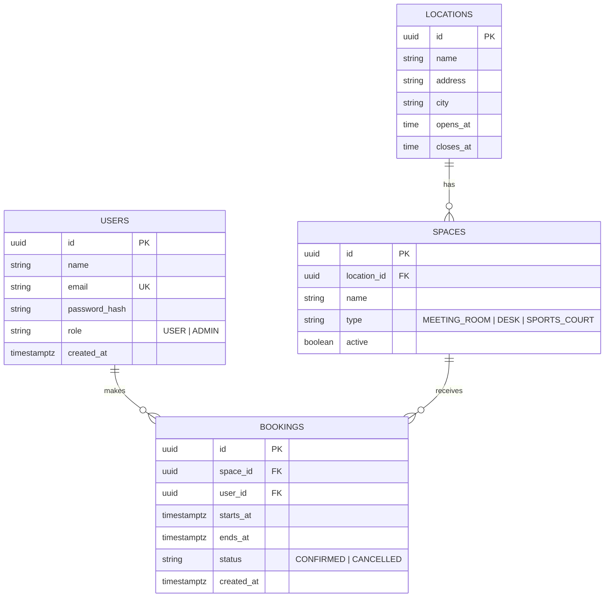

# Project plan

Living plan for the Space Booking API. Decisions are closed (section 11); progress is tracked in the roadmap (section 8).

---

## 1. Overview

**Problem:** booking meeting rooms, coworking desks or sports courts is often done over WhatsApp, phone calls or
spreadsheets. That leads to double bookings, nobody knows what is free, and the owner has no view of usage.

**Solution:** a REST API where users register, check the availability of spaces and book time slots, with clear business
rules (no overlaps, advance limits, per-user limits, cancellation). Admins manage locations and spaces.

**Why this project:** to show, with a live link, the skills job postings ask for most:
**Java + Spring Boot, REST APIs, JWT, PostgreSQL, testing, Docker, CI/CD and cloud**.

**Out of scope (for now):** frontend, real payments, email notifications, mobile app (see "Future work", section 10).

---

## 2. Scope

### MVP
- [ ] Sign-up and login (JWT), roles `USER` and `ADMIN`
- [ ] CRUD of **locations** (building, club) and **spaces** (room, desk, court), admin only
- [ ] **Availability** of a space per day
- [ ] Create, list and **cancel bookings**
- [ ] Booking rules (section 5), with overlap prevention enforced in the database too
- [ ] Swagger/OpenAPI documentation
- [ ] Unit and integration tests (Testcontainers)
- [ ] Dockerfile + docker-compose (app + Postgres)
- [ ] GitHub Actions CI (build + tests) with a README badge
- [ ] Public deployment

### After the MVP (if time allows)
- Recurring bookings (every Tuesday at 8 pm)
- Prices per time band
- Waiting list
- Confirmation emails
- Simple frontend

---

## 3. Stack

| Layer | Choice | Notes |
|---|---|---|
| Language | **Java 21** | Current LTS |
| Framework | **Spring Boot 4.2** | Web, Data JPA, Security, Validation |
| Database | **PostgreSQL 16** | `tstzrange` + exclusion constraint (section 4) |
| Migrations | **Flyway** | Versioned schema, no `ddl-auto=update` |
| Auth | **Spring Security + JWT** | HS256 via Spring's Nimbus support (no extra JWT library), access token only (1 h), no refresh token |
| Docs | **springdoc-openapi** | Swagger UI at `/swagger-ui.html` |
| Tests | **JUnit 5, Mockito, Testcontainers, MockMvc** | Real Postgres in integration tests |
| Build | **Maven** | The most requested in job postings |
| Mapping | **Manual DTO mapping** | Simpler to start with, no MapStruct |
| Container | **Docker + docker-compose** | Multi-stage build |
| CI/CD | **GitHub Actions** | Build, tests, Docker image |
| Deploy | **Render + Neon** | Free tier has cold starts; Postgres on Neon |

---

## 4. Data model



**No-overlap guarantee in the database** (the most important rule; never rely on application code alone):

```sql
CREATE EXTENSION IF NOT EXISTS btree_gist;

ALTER TABLE bookings
  ADD CONSTRAINT no_overlapping_bookings
  EXCLUDE USING gist (
    space_id WITH =,
    tstzrange(starts_at, ends_at) WITH &&
  ) WHERE (status = 'CONFIRMED');
```

Two simultaneous requests for the same slot can never create two bookings: the second one fails in the database and the
API returns `409 Conflict`. This becomes a **concurrency test** and a strong paragraph in the README.

---

## 5. Business rules

| # | Rule | Value |
|---|---|---|
| R1 | Booking must be inside the location's opening hours | `opens_at`-`closes_at` |
| R2 | Fixed duration | 60 min |
| R3 | Start aligned to the full hour | `:00` only |
| R4 | No overlap in the same space | database constraint |
| R5 | No bookings in the past | `starts_at > now()` |
| R6 | Maximum advance | 14 days |
| R7 | Limit of active future bookings per user | 3 |
| R8 | Only the booking owner (or an admin) can cancel | |
| R9 | Minimum notice to cancel | at least 2 h before |
| R10 | Inactive spaces do not accept bookings | |

Time zones: store everything in UTC (`timestamptz`) and convert to `Europe/Madrid` at the edge. Opening hours (`opens_at`, `closes_at`) are interpreted in `Europe/Madrid` for the MVP.

---

## 6. API

Base path: `/api/v1`. Errors follow **RFC 7807** (`application/problem+json`).

### Authentication
| Method | Route | Access | Description |
|---|---|---|---|
| POST | `/auth/register` | public | Sign up |
| POST | `/auth/login` | public | Returns a JWT |
| GET | `/users/me` | authenticated | Current user |

### Locations and spaces
| Method | Route | Access | Description |
|---|---|---|---|
| GET | `/locations` | public | List locations |
| POST / PUT / DELETE | `/locations[/{id}]` | ADMIN | Manage |
| GET | `/locations/{id}/spaces` | public | Spaces of a location |
| POST / PUT / DELETE | `/spaces[/{id}]` | ADMIN | Manage |
| GET | `/spaces/{id}/availability?date=2026-12-01` | public | Free slots for the day |

### Bookings
| Method | Route | Access | Description |
|---|---|---|---|
| POST | `/bookings` | USER | Create a booking |
| GET | `/bookings/me?status=&from=&to=` | USER | My bookings (paginated) |
| GET | `/bookings/{id}` | owner/ADMIN | Details |
| DELETE | `/bookings/{id}` | owner/ADMIN | Cancel (status becomes `CANCELLED`) |
| GET | `/admin/bookings?spaceId=&date=` | ADMIN | Owner's view |

### Expected status codes
`201` created · `400` validation · `401` no token · `403` forbidden · `404` not found ·
`409` slot conflict · `422` business rule violated (e.g. outside opening hours)

---

## 7. Architecture and folder structure

Layered monolith organized **by feature** (not by technical type):

```
space-booking-api/
├── pom.xml
├── Dockerfile
├── docker-compose.yml
├── .github/workflows/ci.yml
├── docs/                    # plan, diagrams, screenshots, Swagger GIF
├── src/main/java/com/thiago/spacebooking/
│   ├── SpaceBookingApiApplication.java
│   ├── config/              # Security, OpenAPI, Clock, CORS
│   ├── common/              # exceptions, global handler (ProblemDetail), pagination
│   ├── auth/                # controller, service, JWT (filter, provider), DTOs
│   ├── user/                # entity, repository, service
│   ├── location/            # entity, repository, service, controller, DTOs
│   ├── space/               # same + availability
│   └── booking/             # same + business rules (BookingPolicy)
├── src/main/resources/
│   ├── application.yml
│   ├── application-dev.yml
│   └── db/migration/        # V1__schema.sql, V2__constraint.sql, V3__seed.sql
└── src/test/java/...        # unit/ and integration/
```

Flow: `Controller (DTO) → Service (rules) → Repository (JPA) → PostgreSQL`.
Design decisions: entities never leave the controllers; an injected `Clock` makes time testable; rules are isolated
in a `BookingPolicy` class that is easy to test.

---

## 8. Roadmap

Each phase ends with a verifiable **"done when"** criterion. Total estimate: **about 3 weeks**.

### Phase 0: Setup (half a day)
- [x] Create the GitHub repository (`space-booking-api`), MIT license, `.gitignore`
- [x] Install and verify: JDK 21, Maven, Docker Desktop
- [x] Generate the project on start.spring.io: Web, Validation, Data JPA, Security, PostgreSQL, Flyway, Actuator, Testcontainers
- [x] First commit and CI workflow (`./mvnw verify`)
- **Done when:** `./mvnw verify` passes locally and on GitHub Actions.

### Phase 1: Database and domain (2 days)
- [x] `docker-compose.yml` with Postgres only
- [x] Flyway migrations V1 (tables) and V2 (exclusion constraint)
- [x] JPA entities and repositories
- [x] Seed data (2 locations in Elche, a coworking and a sports center, 6 spaces, 1 admin)
- **Done when:** the app starts, Flyway applies the migrations and the seed is visible in the database.

### Phase 2: Authentication (3 days)
- [x] `POST /auth/register` with validation and BCrypt password hashing
- [x] `POST /auth/login` returning a JWT (claims: `sub`, `role`, `exp`)
- [x] JWT filter and route/role access rules
- [x] Global error handler (`ProblemDetail`)
- [x] Tests: duplicate sign-up, wrong password, protected route without token
- **Done when:** I can log in and call `/users/me` with the token (verified by tests; Swagger arrives in Phase 5).

### Phase 3: Locations and spaces (2 days)
- [ ] CRUD for locations and spaces (only ADMIN writes)
- [ ] Pagination and filters (`type`, `city`)
- [ ] Controller tests with MockMvc
- **Done when:** an admin creates a space and a regular user can only list.

### Phase 4: Bookings and rules (4 days), the core of the project
- [ ] `BookingPolicy` with R1-R10, each rule with a unit test
- [ ] `POST /bookings`, `GET /bookings/me`, `DELETE /bookings/{id}`
- [ ] Translate the constraint violation into `409 Conflict`
- [ ] `GET /spaces/{id}/availability`
- [ ] **Concurrency test**: 10 threads booking the same slot, only 1 wins
- **Done when:** every rule has a passing test and the concurrency test is stable.

### Phase 5: Quality (2 days)
- [ ] Integration tests with **Testcontainers** (real Postgres)
- [ ] JaCoCo coverage (target at least 80% on `service` and `booking`)
- [ ] Springdoc: examples, descriptions and Bearer security scheme
- [ ] Structured logs and Actuator `/health`
- **Done when:** `./mvnw verify` runs everything and the coverage report is generated.

### Phase 6: Docker (1 day)
- [ ] Multi-stage `Dockerfile` (Maven build, slim JRE runtime, non-root user)
- [ ] Complete `docker-compose.yml` (app + Postgres + healthcheck)
- [ ] Configuration through environment variables (no secrets in the repository)
- **Done when:** `docker compose up` starts everything from scratch and Swagger opens.

### Phase 7: CI/CD (1 day)
- [ ] Workflow: checkout, JDK 21, Maven cache, `verify`, JaCoCo report
- [ ] Build and push the image to GitHub Container Registry
- [ ] CI badge in the README
- **Done when:** a push to `main` runs everything and the badge is green.

### Phase 8: Deployment (1-2 days)
- [ ] Managed Postgres on Neon
- [ ] Image deployment on Render, environment variables, `/actuator/health` as health check
- [ ] Automatic deploy after CI passes
- [ ] Demo data and a test user documented; rotate the seeded demo admin password (`V3__seed_demo_data.sql` is demo-only)
- **Done when:** I open the public Swagger and complete a full flow (sign up, log in, book, cancel).

### Phase 9: Presentation (1-2 days)
- [ ] Final README (section 12): diagrams, GIF of the flow in Swagger, how to run, what I learned
- [ ] Update CV, LinkedIn (Projects and Featured) and pin the repository on GitHub
- [ ] One post telling the story and the concurrency challenge
- **Done when:** live link + post published + CV updated.

### Summary schedule

| Week | Phases | Deliverable |
|---|---|---|
| 1 | 0, 1, 2, 3 | Login and CRUD working |
| 2 | 4, 5 | Bookings with rules and tests |
| 3 | 6, 7, 8, 9 | Docker, CI, deployment and post |

---

## 9. Testing strategy

| Type | Tool | What it covers |
|---|---|---|
| Unit | JUnit 5 + Mockito | `BookingPolicy`, services, JWT |
| Web slice | `@WebMvcTest` + MockMvc | Validation, HTTP codes, per-route security |
| Integration | `@SpringBootTest` + Testcontainers | Full flows on real Postgres, migrations |
| Concurrency | `ExecutorService` | Only one booking wins for the same slot |
| Contract | Generated Swagger | Manual check of the documentation |

---

## 10. Future work
1. Frontend in React or Astro consuming the API
2. Recurring bookings and waiting list
3. Confirmation emails (Spring Mail + MailHog locally)
4. Availability cache (Redis) and rate limiting
5. Observability: Micrometer + Prometheus + Grafana
6. Move notifications to an event-driven module (Kafka)

---

## 11. Decisions

| # | Decision | Choice |
|---|---|---|
| 1 | Domain | **Generic**: locations with spaces of different types (room, desk, court). Elche seed data |
| 2 | Deployment | **Render + Neon** (accept cold starts; documented in the README) |
| 3 | Auth | **Access token only** (JWT, 1-2 h) |
| 4 | Duration and roles | **Fixed 60 min**, roles `USER` and `ADMIN` |
| 5 | Build | **Maven** |
| 6 | DTO mapping | **Manual** (no MapStruct) |
| 7 | Language | **English** for everything: code, commits, API, docs and README |
| 8 | Rules | R6 = 14 days, R7 = 3 active bookings, R9 = cancel with 2 h notice. No no-show handling or maintenance blocks in the MVP |
| 9 | Versions | **Java 21** (LTS) and **Spring Boot 4.2** (start.spring.io only offers 4.x as of Nov 2026) |
| 10 | Repository | **`space-booking-api`**, public |

---

## 12. Final README outline (for recruiters)
1. Title, badges (CI, Java, license) and the **demo link** at the top
2. *What it is* in 2 sentences + Swagger GIF
3. **Key features** and **business rules**
4. **Architecture** (diagram) and **data model**
5. **Design decisions** (exclusion constraint, injected `Clock`, ProblemDetail, Testcontainers)
6. **How to run** (`docker compose up`) and **how to test** (`./mvnw verify`)
7. **API overview** (endpoint table) and demo credentials
8. **What I learned** and next steps
